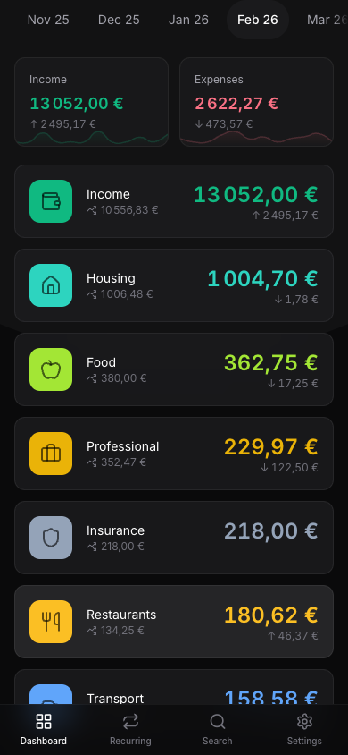
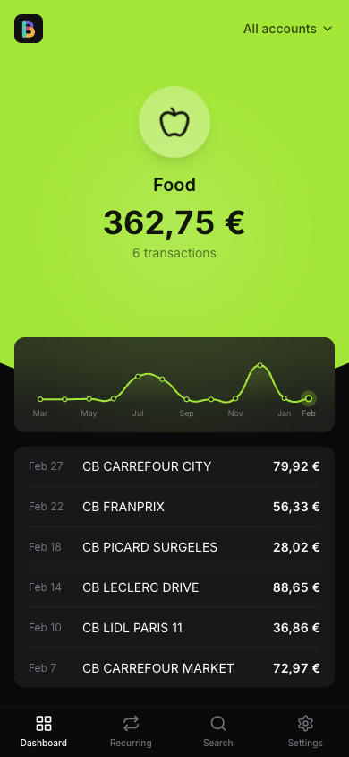
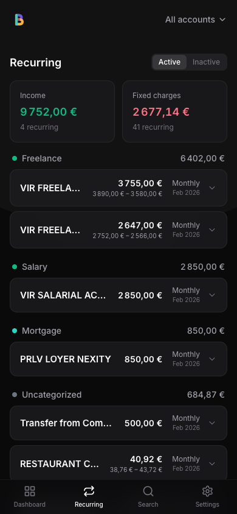

# Budget App

A personal budget management app built with **Laravel 12**, **React 19**, and **Inertia.js 2**. Import your bank CSV statements, automatically categorize transactions with AI (Google Gemini), and visualize your spending by category and month.

<p align="center">
  
  
  
</p>

## Features

- **CSV Import** — Import bank statements from Revolut or Banque Populaire (automatic format detection)
- **AI Categorization** — Transactions are automatically categorized via Google Gemini (3 passes: bank metadata, merchant rules, then AI)
- **Monthly Dashboard** — Spending overview by category with month-over-month comparison
- **Recurring Transactions** — Automatic detection of subscriptions and fixed charges
- **Multi-Account** — Manage multiple bank accounts (personal, professional) in a single interface
- **Search** — Full-text search across all your transactions
- **Merchant Rules** — Create custom rules to automatically categorize transactions from a specific merchant
- **Deduplication** — Already-imported transactions are automatically skipped (SHA-256 hash)
- **PWA** — Installable on mobile as a native-like app
- **MCP Server** — Query your budget data from an AI agent (Claude, etc.)
- **2FA** — Two-factor authentication available

## Prerequisites

| Tool | Version | Notes |
|------|---------|-------|
| **Docker Desktop** | Latest | [docker.com/products/docker-desktop](https://www.docker.com/products/docker-desktop/) |
| **Gemini API Key** | — | Free at [aistudio.google.com/apikey](https://aistudio.google.com/apikey) (required for AI categorization) |

That's it. Docker handles the rest (PHP, PostgreSQL, Redis, Node.js, Bun).

## Installation

### 1. Clone the project

```bash
git clone <repo-url>
cd budget-app
```

### 2. Install PHP dependencies (for Sail)

Since Sail runs inside Docker, you first need to install PHP dependencies via a temporary container:

```bash
docker run --rm \
    -u "$(id -u):$(id -g)" \
    -v "$(pwd):/var/www/html" \
    -w /var/www/html \
    laravelsail/php85-composer:latest \
    composer install --ignore-platform-reqs
```

### 3. Start the containers

```bash
./vendor/bin/sail up -d
```

> **Tip:** Add an alias to your `~/.zshrc` or `~/.bashrc`:
> ```bash
> alias sail='./vendor/bin/sail'
> ```
> The rest of this README uses `sail` as a shorthand.

### 4. Run the full setup

```bash
sail composer setup
```

This command does everything at once:
- Copies `.env.example` to `.env`
- Generates the application key
- Runs database migrations
- Installs frontend dependencies (Bun)
- Builds frontend assets

### 5. Configure the Gemini key

Edit the `.env` file and add your API key:

```
GEMINI_API_KEY=your_key_here
```

### 6. Seed default categories

```bash
sail artisan db:seed --class=CategorySeeder
```

### 7. Start the application

```bash
sail composer dev
```

This starts everything simultaneously:
- The Laravel server
- The queue worker (for async jobs: imports, AI categorization)
- Real-time logs (Pail)
- The Vite dev server (frontend hot reload)

The app is available at **http://localhost**.

## Usage

### First login

1. Go to http://localhost
2. Create an account (standard registration)
3. Optionally enable 2FA in settings

### Importing transactions

1. From the dashboard, click **Import CSV**
2. Select your CSV file (Revolut or Banque Populaire)
3. The format is detected automatically
4. Preview the transactions and choose the target account
5. Confirm the import

Transactions are automatically deduplicated: if you re-import a file, duplicates are skipped.

AI categorization runs in the background via the queue. Reload the page after a few seconds to see the assigned categories.

### Correcting a categorization

- Click on a transaction to manually change its category
- Create a **merchant rule** in settings so all future transactions from that merchant are automatically categorized

## Supported Banks (CSV Parsers)

| Bank | Supported Formats |
|------|-------------------|
| **Revolut** | Personal format (EN/FR), business format |
| **Banque Populaire** | Classic format, enriched format (with categories) |

### Adding a new parser

The architecture is designed to make adding new banks easy. Each parser implements the `CsvParserInterface`:

```php
interface CsvParserInterface
{
    public function canParse(string $content, string $filename): bool;
    public function parse(string $content): Collection;
    public function bankName(): string;
}
```

**Steps to add a bank:**

1. **Create the parser** in `app/Parsers/`:

```php
<?php

namespace App\Parsers;

use Carbon\Carbon;
use Illuminate\Support\Collection;

class MyBankParser implements CsvParserInterface
{
    public function canParse(string $content, string $filename): bool
    {
        // Detect the format via the CSV headers
        $firstLine = strtok($content, "\n");

        return str_contains($firstLine, 'Specific Header');
    }

    /** @return Collection<int, TransactionData> */
    public function parse(string $content): Collection
    {
        $rows = array_map('str_getcsv', explode("\n", $content));
        $headers = array_shift($rows);

        return collect($rows)
            ->filter(fn ($row) => count($row) === count($headers))
            ->map(function ($row) use ($headers) {
                $data = array_combine($headers, $row);

                return new TransactionData(
                    date: Carbon::parse($data['Date'])->format('Y-m-d'),
                    description: $data['Description'],
                    amountCents: (int) round((float) $data['Amount'] * 100),
                    rawLine: implode(',', $row),
                );
            });
    }

    public function bankName(): string
    {
        return 'My Bank';
    }
}
```

2. **Register the parser** in `app/Parsers/CsvParserFactory.php` — add your class to the available parsers array.

3. That's it. Auto-detection will try your parser via `canParse()` on the next import.

**Important notes:**
- Amounts must be in **cents** (integer). Multiply by 100.
- Expenses are **negative**, income is **positive**.
- The `rawLine` field stores the raw CSV line for deduplication.
- You can add optional `bankMetadata` (JSON) if your bank provides enriched data.

## MCP Server (AI Integration)

The app exposes an MCP (Model Context Protocol) server that allows AI agents like Claude to query your budget data in read-only mode.

**Available tools:**

| Tool | Description |
|------|-------------|
| `GetCategoryTotals` | Monthly spending totals by category |
| `QueryTransactions` | Filter by date range, amount, merchant |
| `GetTransactionDetails` | Individual transaction details |
| `GetCategoryBreakdown` | Detailed category analysis |
| `GetMonthlyComparison` | Side-by-side comparison of two months |
| `GetAccountSummary` | Per-account income/expenses/net |

To configure an MCP client (e.g. Claude Desktop), point it to your application's URL. MCP routes are handled by the `laravel/mcp` package.

## Tech Stack

| Layer | Technologies |
|-------|-------------|
| **Backend** | PHP 8.5, Laravel 12, PostgreSQL 16+ (pgvector) |
| **Frontend** | React 19, TypeScript, Inertia.js 2, Tailwind CSS 4, shadcn/ui |
| **AI** | Google Gemini via Laravel AI |
| **Infrastructure** | Docker (Laravel Sail), Redis, Bun |
| **Testing** | PHPUnit (backend), Vitest + Testing Library (frontend) |

## Useful Commands

```bash
# Development
sail up -d                        # Start containers
sail composer dev                 # Run everything (server + queue + logs + Vite)
sail down                         # Stop containers

# Testing
sail composer test                # PHP: lint + PHPUnit
sail artisan test                 # PHPUnit only
sail bun run test                 # Vitest (frontend)

# Linting & Formatting
sail bun run lint                 # ESLint with auto-fix
sail bun run format               # Prettier
sail bun run types                # TypeScript type checking
sail composer lint                # PHP Pint auto-fix

# Database
sail artisan migrate              # Run migrations
sail artisan migrate:fresh --seed # Full reset + seed
```

## Project Structure

```
budget-app/
├── app/
│   ├── Http/Controllers/     # Controllers (thin controllers)
│   ├── Models/               # Eloquent models
│   ├── Services/             # Business logic
│   │   ├── BudgetQueryService        # Dashboard queries
│   │   ├── CsvImportService          # CSV import
│   │   ├── CategorizationService     # Categorization (3 passes)
│   │   ├── DeduplicationService      # SHA-256 deduplication
│   │   ├── RecurringDetectionService # Subscription detection
│   │   └── MerchantMatchingService   # Merchant rules
│   ├── Parsers/              # CSV parsers per bank
│   ├── Mcp/                  # MCP server (AI tools)
│   ├── Jobs/                 # Async jobs
│   └── Events/               # Application events
├── resources/js/
│   ├── pages/                # Inertia page components (React)
│   ├── components/ui/        # shadcn/ui components
│   ├── types/                # TypeScript types
│   └── lib/                  # Utilities (formatAmount, etc.)
├── database/
│   ├── migrations/           # PostgreSQL migrations
│   ├── factories/            # Test factories
│   └── seeders/              # Seeders (categories)
├── routes/
│   ├── web.php               # Main routes
│   └── settings.php          # Settings routes
└── tests/                    # PHPUnit tests
```

## Hosting in Production

### Option 1: Laravel Cloud (recommended)

[Laravel Cloud](https://cloud.laravel.com) is the simplest option:

1. Connect your GitHub repo
2. Set environment variables in the dashboard:
   - `APP_KEY` (generate one with `php artisan key:generate --show`)
   - `GEMINI_API_KEY`
3. PostgreSQL is provisioned automatically
4. Deploy

On first deployment, run the category seeder via the Cloud console:
```bash
php artisan db:seed --class=CategorySeeder --force
```

### Option 2: VPS / Dedicated Server

**Server requirements:**
- PHP 8.5+ with extensions: pdo_pgsql, mbstring, openssl, tokenizer, xml, ctype, json, bcmath, intl
- PostgreSQL 16+ with the `pgvector` extension
- Redis
- Bun (for the frontend build)

**Deployment:**

```bash
# Clone and install
git clone <url> /var/www/budget-app
cd /var/www/budget-app
composer install --no-dev --optimize-autoloader
bun install
bun run build

# Configure
cp .env.example .env
# Edit .env with your production settings (DB, APP_URL, GEMINI_API_KEY, etc.)
php artisan key:generate
php artisan migrate --force
php artisan db:seed --class=CategorySeeder --force

# Optimize
php artisan config:cache
php artisan route:cache
php artisan view:cache

# Queue worker (via supervisor or systemd)
php artisan queue:work --tries=3 --timeout=120
```

Configure your web server (Nginx or Caddy) to point to `/var/www/budget-app/public`.

### Option 3: Docker in Production

You can reuse Sail or create your own `docker-compose.prod.yml`. The essentials are:
- A PHP-FPM container
- PostgreSQL 16+ with pgvector
- Redis
- A reverse proxy (Nginx/Caddy)
- A queue worker

## Environment Variables

| Variable | Description | Required |
|----------|-------------|----------|
| `APP_KEY` | Laravel encryption key | Yes (generated during setup) |
| `APP_URL` | Application URL | Yes |
| `DB_*` | PostgreSQL connection | Yes |
| `GEMINI_API_KEY` | Google Gemini API key | Yes (for AI categorization) |
| `QUEUE_CONNECTION` | Queue driver (`database` or `redis`) | No (default: `database`) |
| `CACHE_STORE` | Cache driver | No (default: `file`) |
| `MAIL_*` | Email configuration | No (Mailpit in local) |

## Technical Conventions

- **Amounts**: Stored as **integer cents**. 15.99 EUR = `1599`. Displayed in French locale format via `formatAmount()`.
- **Routing**: No SPA router — Inertia.js handles navigation with Laravel's server-side routing.
- **TypeScript**: Strict mode, separate type imports (`import type { ... }`).
- **Frontend package manager**: Bun (not npm or yarn).

## License

Personal use. Feel free to fork for your own use.
