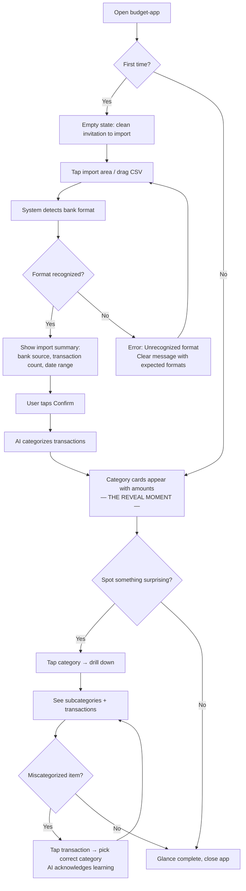
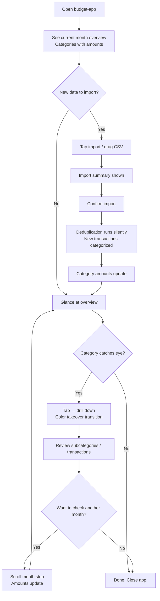
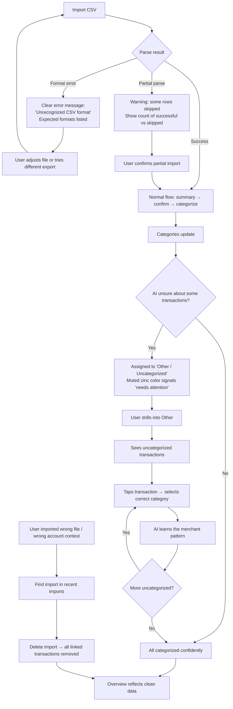
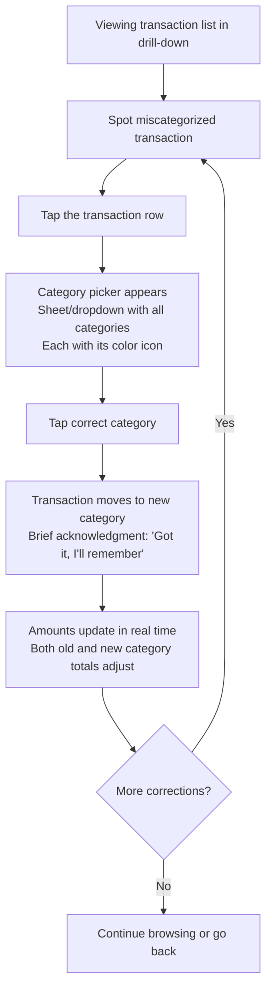

# UX Design Specification budget-app

**Author:** Lambert
**Date:** 2026-02-19

---

<!-- UX design content will be appended sequentially through collaborative workflow steps -->

## Executive Summary

### Project Vision

budget-app answers "where does my money go?" in under a minute. CSV imports from Banque Populaire and Revolut are auto-categorized by AI, presented as a clean category overview with drill-down to individual transactions. An MCP server enables conversational financial queries through Claude. Radical simplicity -- no onboarding, no settings, no coaching. A mirror, not a tool.

### Target Users

Single user (Lambert) -- solo developer, Chrome on iPhone and Mac. Bi-weekly usage pattern: export CSVs, import, review, close. Under 2 minutes per session. Low tolerance for friction, high expectation for clarity. Technical enough to deploy and maintain but expects the app itself to require zero configuration.

### Key Design Challenges

- **The 2-minute loop** -- Import → review → done must feel effortless. Import friction kills the habit.
- **Instant category correction** -- Correcting AI mistakes must be a single-tap interaction, not a form.
- **3-level drill-down on mobile** -- Categories → Subcategories → Transactions must feel like natural navigation on a small screen.
- **Empty state to first value** -- Transition from zero data to full financial picture must feel rewarding.

### Design Opportunities

- **The reveal moment** -- First import fills categories with amounts in real time. The app earns trust in this single interaction.
- **Information density without clutter** -- Radical simplicity means no nav bars, no sidebars, no settings. Just data, big numbers, clear categories.
- **Mobile-first = focus-first** -- iPhone screen forces progressive disclosure. Drill-down becomes a focused reveal, not a data dump.

## Core User Experience

### Defining Experience

The app is one screen. Open it, see where your money goes. The category overview IS the app -- no dashboard, no navigation menu, no welcome state after first use. Categories with amounts, current month, updated every time you import.

The core loop: **open → glance → (optionally drill down) → close**. Under a minute for a returning user. The import loop: **drag CSV → confirm → watch categories update → done**. Under 2 minutes including the bank export.

### Platform Strategy

- **Primary:** Chrome on iPhone (mobile-first design target)
- **Secondary:** Chrome on Mac (same functionality, wider layout)
- **Input:** Touch on mobile, mouse + drag-and-drop on desktop
- **No separate platforms** -- single responsive web app, no native apps, no PWA for MVP
- **Always online** -- requires server for data, no offline mode

### Effortless Interactions

- **Import** -- Drag a file onto the overview (desktop) or tap to pick a file (mobile). The system parses and shows a brief summary (transaction count, bank source, date range) for confirmation before committing. One tap to confirm, transactions flow in, categories update. No column mapping, no multi-step wizard.
- **Category correction** -- Tap a miscategorized transaction, pick the right category from a list. One interaction, done. The AI remembers.
- **Month navigation** -- Left/right arrows with month label. No calendar picker, no date range selector.
- **Account toggle** -- Personal/Professional switch on the overview. Defaults to personal. Toggling updates all numbers instantly.
- **Import deletion** -- Undo an entire import and all its linked transactions. Accessible but not prominent -- prevents accidental misimport (e.g., wrong account context) without being a footgun.

### Critical Success Moments

1. **First import reveal** -- Categories fill with amounts for the first time. This is the "where has my money been going" moment. If this doesn't feel clear and immediate, the app fails.
2. **The correction that sticks** -- User corrects a category, imports again next time, and the merchant is categorized correctly. Trust in the AI established.
3. **The under-a-minute check-in** -- Returning user opens app, glances at overview, maybe drills into one category, closes. If this takes more than a minute, the habit dies.
4. **The number that surprises** -- A category amount is unexpectedly high or low. This is the moment that drives behavioral change. The UI must make these numbers impossible to miss.

### Experience Principles

1. **One screen, one truth** -- The overview is the app. Everything else is a drill-down from it or an action on it. No pages, no navigation hierarchy beyond the 3-level drill-down.
2. **Import is lightweight** -- Drop a file, confirm the summary, numbers update. No workflow, no multi-step wizard.
3. **Corrections, not configurations** -- The app never asks you to set things up. It makes its best guess and you correct it. Settings are replaced by corrections that make the system smarter.
4. **Numbers speak** -- Big, clear category amounts are the primary UI element. Everything else serves the numbers. No charts, no graphs, no visualizations for MVP -- just clear typography and hierarchy.

> **Note:** Import deletion and import confirmation are new capabilities discovered during UX design. These should be added to the PRD as FR34 and FR35.

## Desired Emotional Response

### Primary Emotional Goals

- **Calm clarity** -- Opening the app feels like checking the weather. No stress, no judgment. Just a clean picture of what is.
- **Honest awareness** -- Surprising numbers create a "huh, interesting" moment, not a "you messed up" moment. The insight comes from the data, not from the app.
- **Quiet satisfaction** -- The ritual of importing and reviewing feels like a small act of self-care. You look forward to the bi-weekly check-in.

### Emotional Journey Mapping

| Moment | Feeling | Design Implication |
|--------|---------|-------------------|
| First open (empty state) | Curiosity, anticipation | Clean invitation to import, not a barren void |
| First import reveal | Surprise, clarity | Numbers appear with presence -- big, clear, undeniable |
| Spotting a high category | Honest awareness, not guilt | Neutral presentation -- no red warnings, no exclamation marks |
| Correcting the AI | Teaching, collaboration | Feedback that the correction was noted -- the AI is learning |
| Returning bi-weekly | Ritual anticipation | Familiar, fast, rewarding -- like a habit you chose |
| Seeing AI improve over time | Trust, satisfaction | Fewer corrections needed = visible proof the system is getting smarter |
| Something goes wrong | Brief concern → relief | Clear error messages, easy undo, no data loss anxiety |

### Micro-Emotions

- **Confidence over confusion** -- Every screen should be instantly readable. No moment of "where am I?" or "what does this mean?"
- **Trust over skepticism** -- AI categorization earns trust through transparency (corrections acknowledged) and improvement over time
- **Accomplishment over tedium** -- The import ritual should feel like you did something meaningful in under 2 minutes, not like you did chores

### Emotional Design Principles

1. **No judgment in the UI** -- No red/green color coding for spending. No "over budget" warnings. No emoji reactions to amounts. The app presents facts; the user decides what they mean.
2. **The AI is a learner, not an authority** -- When corrections happen, the tone is "got it, I'll remember" -- not "are you sure?" The user is always right.
3. **Ritual, not routine** -- Small design touches should make the bi-weekly check-in feel like a moment of clarity, not a task to complete. The reveal of updated numbers should feel satisfying.
4. **Calm confidence** -- The visual language should be quiet, spacious, and precise. No busy layouts, no competing elements. Every pixel serves the numbers.

## UX Pattern Analysis & Inspiration

### Inspiring Products Analysis

**Motivated (Habit Tracker) -- Primary Inspiration**

Motivated is a habit tracking app for iOS that embodies the "calm clarity" emotional goal budget-app is targeting, but through a vibrant rather than muted visual language. Key UX characteristics:

- **Visual Architecture:** Deep black background (#1C1C1E range) with vibrant, saturated accent colors assigned per habit. Each item has its own color identity -- yellow, orange, pink, blue, green -- creating instant visual recognition without labels.
- **Card Layout:** Rounded rectangle cards in dark gray (#2C2C2E range) with generous padding and spacing. Each card follows a consistent structure: colored icon (left), name and subtitle (center), action element (right). The simplicity of the structure makes the list scannable in under a second.
- **Drill-Down Transformation:** Tapping an item transitions from the dark list to a detail view where the item's accent color dominates the top half of the screen. This color takeover creates a dramatic sense of "entering" the item's space -- a satisfying, identity-rich interaction.
- **Information Density:** Big, bold numbers (0%, completion counts) are the hero elements. Supporting data lives in dark cards below. No charts, no complex visualizations -- just clear typographic hierarchy.
- **Navigation Minimalism:** Three unlabeled icons at the bottom (grid, add, stats). Week strip at the top with day dots. No sidebar, no hamburger, no tab labels. Navigation is discoverable through spatial position, not text.
- **Color as Data:** Small colored dots under each day in the week strip communicate completion status without words. Color does the work that text or numbers would in a less refined app.

### Transferable UX Patterns

**Navigation Patterns:**
- **Week strip with dot indicators** -- Translates to budget-app's month navigation. A horizontal month strip with subtle indicators (dots for data completeness, or activity level) gives temporal context without a heavy calendar widget.
- **Minimal bottom nav** -- budget-app needs even less navigation than Motivated. The overview IS the app. A bottom bar with just import action and account toggle could work.

**Interaction Patterns:**
- **Card-based list as home screen** -- Categories as cards mirrors habits as cards. Each spending category gets a vibrant color icon, category name, and amount. Same scan-in-a-second quality.
- **Color-dominant drill-down** -- Tapping a category floods the detail view with that category's color. Food is green, Restaurants is orange, Transport is blue. The color shift signals "you're inside this category now."
- **Single-tap actions** -- Motivated's checkbox completion maps to budget-app's single-tap category correction. Minimal interaction, maximum effect.

**Visual Patterns:**
- **Dark canvas + vibrant accents** -- Supports the "calm clarity" emotional goal. The dark background recedes; the colorful categories demand attention. Numbers pop against dark cards.
- **Big number as hero** -- Category amounts should be as bold and undeniable as Motivated's 0% gauge. The number IS the content.
- **Generous whitespace** -- Breathing room between cards prevents the data-heavy feel that kills finance apps. budget-app shows financial data but should feel as spacious as Motivated.

### Anti-Patterns to Avoid

- **Dashboard overload** -- Finance apps like Finary/Bankin pack dashboards with charts, graphs, alerts, and partner promotions. Motivated proves that a simple card list with color and big numbers is more effective than any dashboard.
- **Gray-on-gray neutrality** -- Many "minimal" finance apps go too neutral (all grays, muted tones). Motivated shows that vibrant color and minimalism are not opposites. budget-app should be colorful AND clean.
- **Text-heavy navigation** -- Tab bars with 5 labeled icons, settings pages with endless toggles. Motivated's 3 unlabeled icons prove that spatial memory beats text labels for a single-user app.
- **Configuration before value** -- Finance apps that demand account setup, category customization, and preference wizards before showing any data. budget-app should follow Motivated's pattern: drop in data, see results immediately.
- **Judgment in the UI** -- Red/green spending indicators, "over budget" warnings, guilt-inducing language. Motivated shows a "Weak" label but frames it as gentle guidance ("consider adjusting"). budget-app should present facts, not verdicts.

### Design Inspiration Strategy

**What to Adopt:**
- Dark background with vibrant, category-specific accent colors as the core visual language
- Card-based list layout with icon + name + amount structure for the category overview
- Color-dominant drill-down transition where the category's color takes over the detail view
- Big, bold numbers as the primary visual element in every view
- Generous spacing and padding -- the app should breathe

**What to Adapt:**
- Motivated's week strip becomes a month navigation strip with optional data indicators
- Motivated's per-item color assignment becomes per-category color assignment (Food = green, Restaurants = orange, etc.) -- but budget-app needs a coherent palette that works across 10-15 categories
- Motivated's bottom nav simplifies further -- budget-app may need only contextual actions, not a persistent nav bar
- The drill-down detail view adapts from habit stats to subcategory breakdown and transaction list, maintaining the color-dominant header

**What to Avoid:**
- Charts and graphs for MVP -- numbers and color do the work
- Text labels on navigation -- spatial memory and iconography
- Muted, "serious" finance aesthetics -- vibrant color is the differentiator
- Any configuration or settings screen -- corrections replace configuration, just like Motivated's simplicity

> **Note:** The dark theme with vibrant category colors represents a significant design direction for budget-app. This should be reflected in the visual foundation and design system choices in upcoming steps.

## Design System Foundation

### Design System Choice

**Primary: Tailwind CSS (custom design system)**
**Secondary: shadcn/ui (interactive primitives as needed)**

Tailwind CSS as the design foundation with fully custom components. shadcn/ui components pulled in selectively for complex interactive elements (dropdowns, dialogs, popovers) where building from scratch adds no value. shadcn/ui is built on Tailwind + Radix, so it integrates seamlessly without introducing a second design language.

### Rationale for Selection

- **Visual control** -- The Motivated-inspired dark theme with vibrant category colors requires precise control over every visual detail. Tailwind's utility-first approach gives that control without abstraction layers.
- **Small component surface** -- budget-app has very few unique components (category cards, transaction lists, month strip, import area, correction picker). A full component library would be overhead for this scope.
- **Solo developer efficiency** -- Tailwind's utility classes allow rapid iteration directly in markup. No context-switching between component files and style files. What you see is what you style.
- **No visual baggage** -- No library defaults to override. The app looks exactly like the design, not like "themed Material Design" or "customized Ant."
- **shadcn/ui as escape hatch** -- For interactive patterns that are hard to get right (accessible dropdowns, focus management in dialogs, keyboard navigation), shadcn/ui provides battle-tested primitives that are fully customizable and Tailwind-native.

### Implementation Approach

- **Tailwind config** as the single source of truth for the design system: color palette (dark background, vibrant category accents), spacing scale, border radius tokens, typography scale
- **Custom components** built with Tailwind utilities for: category cards, transaction rows, month navigation strip, import drop zone, account toggle
- **shadcn/ui components** adopted selectively for: category correction dropdown/picker, import confirmation dialog, any future modal or popover interactions
- **Dark mode as default** -- not a toggle. The app is dark. Tailwind's dark mode utilities used only if light elements are needed within the dark context (e.g., color-dominant drill-down headers)

### Customization Strategy

- **Tailwind theme extension** defines the full visual vocabulary: category color palette (10-15 vibrant colors), dark surface layers (background, card, elevated card), typography (sizes, weights, line heights for big numbers vs. labels)
- **Component patterns** documented as Tailwind class compositions, not as a separate component library. The app is small enough that patterns live in the code, not in a design system package.
- **shadcn/ui theming** via CSS variables aligned to the Tailwind config, ensuring shadcn components inherit the dark + vibrant aesthetic without manual overrides

## Defining Experience

### The Core Interaction

**"Import a file, instantly see where your money goes."**

This is budget-app's Shazam moment. A CSV file goes in, vibrant category cards with bold amounts come out. The complexity of hundreds of bank transactions collapses into a scannable list of colored cards. The AI does the work; the user gets the clarity.

The defining experience is not a single interaction but a two-beat rhythm:
1. **The reveal** -- Categories fill with amounts. The financial picture materializes.
2. **The surprise drill-down** -- A number catches your eye. You tap. Subcategories, then transactions. The answer is always one or two taps away.

If these two beats feel right, the app succeeds. Everything else -- month navigation, account toggle, corrections -- is infrastructure supporting this core rhythm.

### User Mental Model

Lambert approaches budget-app with no existing financial tracking habit. There is no mental model to match or break -- the app creates one from scratch.

**The mental model budget-app establishes:**
- **The app is a mirror** -- It reflects what happened. It doesn't plan, suggest, or judge. Open it, look, close it.
- **Categories are the unit of understanding** -- Not individual transactions, not daily totals, not account balances. "How much did I spend on Restaurants?" is the atomic question.
- **Corrections teach the system** -- When the AI is wrong, fixing it isn't a chore -- it's training. The effort has compounding returns.
- **CSV import is the refresh button** -- New data enters through file import. No sync, no automation. A deliberate, bi-weekly ritual.

**Where confusion could arise:**
- First import with many "Other/Uncategorized" items -- needs to feel like a starting point, not a failure
- Subcategory vs. category distinction -- must be obvious from the drill-down hierarchy, not require explanation
- Deduplication happening silently -- user needs enough confidence to re-import without anxiety, even without visible feedback

### Success Criteria

The core experience succeeds when:

- **Scannable in under 5 seconds** -- Opening the overview, the eyes land on the biggest numbers first. Color and size create instant hierarchy. No reading required to get the gist.
- **Surprise is visible, not hidden** -- An unusually high category amount is impossible to miss. The big number on a vibrant card does this naturally.
- **Drill-down resolves curiosity in one tap** -- Tap the surprising category, see what's inside. No loading state, no page transition that breaks flow. The color-dominant detail view (Motivated-style) signals "you're inside this category."
- **Import feels like progress** -- Dropping a CSV and watching categories update should feel rewarding, not administrative. The reveal of updated numbers is the payoff.
- **Corrections feel lightweight** -- Fixing a miscategorized transaction is a single tap to select the right category. No confirmation dialog, no "are you sure." The correction is immediate and the AI acknowledges it learned.

### Novel UX Patterns

budget-app uses **established patterns combined in a focused way** rather than novel interactions:

**Established patterns adopted:**
- **Card-based list** -- Proven scannable layout (Motivated, iOS Settings, any modern list UI)
- **Drill-down navigation** -- Category → Subcategory → Transaction follows the universal list → detail pattern
- **File upload** -- Drag-and-drop (desktop) and file picker (mobile) are standard browser patterns
- **Month navigation** -- Left/right arrows with label, used in every calendar and finance app

**The innovation is in what's removed, not what's added:**
- No onboarding, no setup, no configuration -- the first action is importing data
- No charts, no graphs, no visualizations -- numbers and color do the work
- No navigation menu -- the overview IS the app, drill-down is the only navigation
- No settings -- corrections replace configuration

This "innovation by subtraction" means zero learning curve. Every interaction uses a pattern Lambert already knows. The product feels new because of what's missing, not because of unfamiliar interactions.

### Experience Mechanics

**Beat 1: The Reveal (Import → Overview)**

| Phase | What Happens | What the User Sees |
|-------|-------------|-------------------|
| Initiation | Drag CSV onto overview (desktop) or tap to pick file (mobile) | Drop zone appears or file picker opens |
| Processing | System parses CSV, AI categorizes transactions | Brief import summary: transaction count, bank source, date range |
| Confirmation | User confirms the import | Single tap to confirm |
| Reveal | Transactions commit, category amounts update | Category cards update with new amounts. The numbers change. |
| Completion | Import is done | Overview reflects the new financial picture |

**Beat 2: The Surprise Drill-Down (Overview → Detail)**

| Phase | What Happens | What the User Sees |
|-------|-------------|-------------------|
| Trigger | A category amount catches the eye | Bold number on a vibrant card -- impossible to miss |
| Tap | User taps the category card | Category's accent color floods the detail view header (Motivated-style transition) |
| Subcategories | System shows subcategory breakdown | Subcategory list with amounts, still within the category's color context |
| Transactions | User taps a subcategory | Individual transactions: date, merchant, amount |
| Resolution | Curiosity satisfied | User taps back or closes. The "huh" moment is resolved. |

**Beat 3: The Correction (when needed)**

| Phase | What Happens | What the User Sees |
|-------|-------------|-------------------|
| Trigger | A transaction is in the wrong category | User spots it while drilling down |
| Tap | User taps the transaction | Category picker appears (shadcn/ui dropdown or sheet) |
| Correction | User selects the right category | Transaction moves to new category. Brief acknowledgment that the AI learned. |
| Completion | Done | Amounts update. One tap, done. |

## Visual Design Foundation

### Color System

**Surface Layers (Dark Theme)**

| Token | Value | Usage |
|-------|-------|-------|
| `background` | `#0A0A0B` | App background -- near-black with a hint of warmth |
| `surface` | `#1C1C1E` | Card backgrounds -- the dark gray from Motivated |
| `surface-elevated` | `#2C2C2E` | Elevated elements (modals, popovers, hover states) |
| `surface-subtle` | `#161618` | Subtle separation between sections |
| `border` | `#2C2C2E` | Borders when needed -- same as elevated surface, barely visible |

**Text**

| Token | Value | Usage |
|-------|-------|-------|
| `text-primary` | `#FFFFFF` | Category names, amounts -- high contrast |
| `text-secondary` | `#A1A1AA` | Subtitles, labels, dates -- zinc-400 |
| `text-tertiary` | `#71717A` | Hints, placeholders -- zinc-500 |

**Category Accent Palette**

Each spending category owns a vibrant color. These are saturated but not neon -- warm, friendly, Motivated-inspired.

| Category | Color | Hex | Rationale |
|----------|-------|-----|-----------|
| Food & Groceries | Lime | `#A3E635` | Fresh, natural association |
| Restaurants & Dining | Amber | `#FBBF24` | Warm, convivial, dining warmth |
| Transport | Blue | `#60A5FA` | Movement, travel, calm |
| Housing & Utilities | Teal | `#2DD4BF` | Stable, foundational |
| Entertainment | Purple | `#C084FC` | Leisure, fun, playful |
| Shopping | Pink | `#F472B6` | Retail, impulse, energy |
| Health & Wellness | Mint | `#34D399` | Vitality, care |
| Subscriptions | Coral | `#FB7185` | Recurring, attention-worthy |
| Education | Sky | `#38BDF8` | Growth, learning |
| Travel | Indigo | `#818CF8` | Adventure, distance |
| Insurance & Banking | Slate | `#94A3B8` | Institutional, neutral |
| Income | Emerald | `#10B981` | Positive, growth, money in |
| Professional | Gold | `#EAB308` | Business, distinct from personal |
| Other / Uncategorized | Zinc | `#A1A1AA` | Intentionally muted -- awaiting classification |

These colors are drawn from Tailwind's extended palette at the 400 level, ensuring they're vibrant on dark backgrounds while remaining part of a coherent system. Each has enough saturation to own the drill-down header (Motivated-style color takeover) while being distinct from its neighbors.

**Semantic Colors**

| Token | Value | Usage |
|-------|-------|-------|
| `success` | `#10B981` | Import success, correction acknowledged |
| `error` | `#EF4444` | Import failure, parsing errors |
| `info` | `#60A5FA` | Informational states |

> **Note:** No warning color defined intentionally. The app does not warn about spending -- it presents facts. No red/green spending judgment.

### Typography System

**Typeface: Inter**

Inter is the sole typeface. Open source, excellent number rendering with tabular figures, highly legible at all sizes, and native to the modern web aesthetic. Variable font for precise weight control.

**Type Scale**

| Token | Size | Weight | Usage |
|-------|------|--------|-------|
| `display` | 36px / 2.25rem | 700 (Bold) | Hero category amount on drill-down header |
| `heading-lg` | 24px / 1.5rem | 600 (Semibold) | Category amounts on overview cards |
| `heading-md` | 20px / 1.25rem | 600 (Semibold) | Section titles, month label |
| `heading-sm` | 16px / 1rem | 600 (Semibold) | Subcategory amounts, card titles |
| `body` | 14px / 0.875rem | 400 (Regular) | Category names, transaction merchants |
| `body-sm` | 12px / 0.75rem | 400 (Regular) | Dates, secondary labels, subtitles |
| `caption` | 11px / 0.6875rem | 500 (Medium) | Badges, status indicators |

**Number Rendering:**
- All financial amounts use `font-variant-numeric: tabular-nums` for aligned columns
- Euro symbol follows the amount with a thin space
- Amounts are right-aligned within their containers for scanability

### Spacing & Layout Foundation

**Base Unit: 4px**

All spacing derives from a 4px base, with most UI using multiples of 8px.

| Token | Value | Usage |
|-------|-------|-------|
| `space-1` | 4px | Tight gaps (icon to text within a row) |
| `space-2` | 8px | Default inner padding, compact list items |
| `space-3` | 12px | Between text lines, between related elements |
| `space-4` | 16px | Card inner padding, standard element gap |
| `space-5` | 20px | Between cards in the overview list |
| `space-6` | 24px | Section padding, header spacing |
| `space-8` | 32px | Major section breaks, screen-level padding |

**Layout Principles:**

- **Overview cards:** `space-4` (16px) inner padding, `space-5` (20px) gap between cards. Generous -- the cards breathe, like Motivated.
- **Transaction lists (drill-down):** `space-2` (8px) vertical padding per row, `space-3` (12px) gap. Denser than the overview -- more items visible per screen -- but not cramped. Each row still has clear tap targets.
- **Screen margins:** `space-4` (16px) on mobile, `space-8` (32px) on desktop. Content stays inset from screen edges.
- **Border radius:** `12px` for cards (matching Motivated's rounded rectangles), `8px` for buttons and smaller elements, `full` (999px) for circular indicators.

**Responsive Behavior:**
- Mobile (< 640px): Single column, full-width cards, 16px margins
- Desktop (>= 640px): Single column with max-width constraint (~480px centered), 32px margins. The app doesn't spread to fill a wide screen -- it stays focused like a mobile app on desktop, matching the "one screen, one truth" principle.

### Accessibility Considerations

- **Contrast:** White text (#FFFFFF) on surface (#1C1C1E) exceeds WCAG AAA ratio (>7:1). Secondary text (#A1A1AA) on surface meets WCAG AA (>4.5:1).
- **Touch targets:** Minimum 44px height for all tappable elements on mobile (card rows, correction picker items, month navigation arrows).
- **No color-only information:** Category colors are always paired with text labels and amounts. Color reinforces identity but is never the sole carrier of meaning.

> **Note:** Formal WCAG compliance is not required (single-user app), but these baselines ensure the app is comfortable to use -- no squinting, no mis-taps.

## Design Direction Decision

### Design Directions Explored

Six design directions were generated and evaluated as interactive mockups (`ux-design-directions.html`):

- **A: Classic Cards** -- Motivated-style icon + name + amount. Balanced but safe.
- **B: Numbers First** -- Hero total, compact rows with percentages. Analytical, dense.
- **C: Color Bars** -- Left accent bars with progress indicators. Data-rich.
- **D: Minimal List** -- Flat list, color dots, no cards. Ultra-clean reduction.
- **E: Motivated-Faithful** -- Large icons, bold cards, month strip. Most personality.
- **F: Split View** -- Income/expense summary cards above categorized list. Financial context first.

### Chosen Direction

**Hybrid of E + F + D: "Bold Clarity"**

A combination that takes the best elements from three directions:

**From E (Motivated-Faithful):**
- Scrollable horizontal month strip -- swipe through months naturally, the primary temporal navigation
- Bold card layout with large (48px) colored icons in rounded squares, category name, and prominent amount
- Generous spacing between cards -- the overview breathes

**From F (Split View):**
- Account picker in the top-right header area ("Personal ▾") -- clean dropdown toggle between Personal and Professional, always accessible but never in the way
- Income/Expenses summary widget -- two compact cards at the top showing income and total expenses side by side. Gives immediate financial context before drilling into categories.

**From D (Minimal List):**
- The spirit of clean simplicity and focus. No unnecessary chrome. The data speaks.

**Drill-Down:**
- Motivated-style color takeover -- the tapped category's accent color floods the header
- Subcategory breakdown in a grouped card
- Individual transactions in denser rows (8px vertical padding) for scanability
- Close button returns to overview

### Design Rationale

- **The month strip from E is more tactile than arrows** -- scrolling through months feels natural on mobile, gives a sense of temporal context (you can see neighboring months), and follows the Motivated pattern Lambert already loves.
- **The account picker from F is minimal and correct** -- Personal/Professional is a context switch, not a navigation action. A dropdown in the header treats it as what it is: a filter.
- **The income/expenses widget from F provides instant context** -- Before looking at categories, knowing "Income: 3 200 € / Expenses: 2 847 €" answers the first question ("am I net positive this month?"). This takes two small cards worth of space and earns its keep.
- **E's bold cards are the Motivated DNA** -- Large colored icons, generous spacing, vibrant amounts. This is what Lambert loves about Motivated, translated to financial data.
- **The drill-down color takeover is the signature interaction** -- It transforms the screen from neutral dark to category-owned color space. This is the moment that makes budget-app feel designed, not generic.

### Implementation Approach

**Screen Structure (top to bottom):**

1. **Header bar** -- "budget-app" title (left), account picker "Personal ▾" (right)
2. **Month strip** -- Horizontally scrollable month pills, current month highlighted. Dots or subtle indicators under months with data.
3. **Summary widget** -- Two side-by-side cards: Income (emerald) and Expenses (coral). Bold amounts.
4. **Category cards** -- Scrollable list of bold cards. Each card: colored icon (left), category name + transaction count (center), amount in category color (right). Sorted by amount descending.
5. **Bottom area** -- Import action button (floating or inline at bottom of list). Minimal.

**Drill-Down Structure:**
1. **Color header** -- Category accent color background, large centered icon, category name, total amount, transaction count
2. **Subcategories section** -- Grouped card with subcategory rows (name + amount + chevron)
3. **Transactions section** -- Grouped card with denser rows (date + merchant + amount). Tappable for category correction.

**Responsive Adaptation:**
- Mobile: Full-width, single column, 16px margins
- Desktop: Centered column (~480px max-width), 32px margins. Same layout, just more breathing room around it.

## User Journey Flows

### Journey 1: First Import

The app's defining moment. Empty state to full financial picture in under 3 minutes.

**Key UX decisions:**
- Empty state is an invitation, not a void -- clean import area with a subtle prompt
- Import summary is brief: bank name, count, date range. One tap to confirm.
- The reveal is the payoff -- categories with bold amounts appearing on the dark canvas
- No onboarding, no tutorial. The first action IS the onboarding.

### Journey 2: Regular Check-in

The bi-weekly ritual. Under 1 minute for a returning user.

**Key UX decisions:**
- Opening the app shows the current month immediately -- no loading screen, no welcome back
- Import integrates into the existing overview -- not a separate flow
- Deduplication is invisible. Re-importing the same file does nothing harmful.
- Month navigation via scrollable strip -- swipe to compare periods naturally

### Journey 3: Error & Edge Cases

When things go wrong, recovery is always clear and fast.

**Key UX decisions:**
- Errors are specific and actionable -- never "something went wrong"
- "Other/Uncategorized" is visually muted (zinc color) signaling "this needs your input" without alarm
- Import deletion is the safety net for wrong-file imports -- accessible but not prominent
- Partial imports are allowed with clear feedback on what was skipped

### Journey 4: Category Correction

The single most important micro-interaction. Must feel instant.

**Key UX decisions:**
- Single tap to open picker, single tap to select. Two taps total.
- No confirmation dialog ("are you sure?") -- the correction is immediate
- Brief, warm acknowledgment that the AI learned -- "Got it, I'll remember" as a subtle toast or inline message
- Amounts update in real time across the UI -- the correction's impact is immediately visible
- The category picker shows all categories with their color icons for quick visual scanning

### Journey Patterns

**Reusable patterns across all journeys:**

**Navigation Pattern: Drill-Down Stack**
- Overview → Category (color takeover) → Subcategory → Transaction
- Back navigation at each level (close button or swipe back)
- Each level maintains context of where you came from

**Feedback Pattern: Silent Success, Clear Errors**
- Successful actions (import, correction, deduplication) happen silently or with minimal feedback
- Errors always explain what happened and what to do next
- No unnecessary confirmations -- trust the user's intent

**Data Pattern: Instant Reflection**
- Every data change (import, correction) is reflected immediately in all visible amounts
- No "save" button, no "refresh needed" -- the UI is always current
- Month navigation updates all numbers instantly

**Interaction Pattern: Progressive Disclosure**
- Overview shows categories + amounts (scan in 5 seconds)
- Drill-down reveals subcategories (one tap deeper)
- Transaction level reveals individual items (two taps deep)
- Correction is available at the deepest level where context is richest

### Flow Optimization Principles

1. **Zero-step onboarding** -- The first meaningful action (import) IS the onboarding. No tour, no tips, no "get started" wizard.
2. **Two-tap maximum for any action** -- Import: tap + confirm. Correction: tap transaction + tap category. Month change: scroll. Account switch: tap dropdown + tap option.
3. **Silent deduplication** -- The user should never think about whether they already imported a file. Import freely, the system handles it.
4. **Error recovery without anxiety** -- Wrong import? Delete it. Wrong category? Fix it. The app never creates a state that can't be easily undone.
5. **The "Other" category as a funnel** -- Uncategorized items naturally draw the user to correct them, which trains the AI. The muted zinc color is intentionally less satisfying than the vibrant category colors -- it creates gentle motivation to categorize.

## Component Strategy

### Design System Components

**From shadcn/ui (adopted as-is, themed to match):**

| Component | Usage | Customization |
|-----------|-------|---------------|
| **DropdownMenu** | Account picker ("Personal ▾") in header | Dark theme, vibrant accent on active item |
| **Sheet** | Category correction picker on mobile (slides up from bottom) | Full category list with color icons, dark surface background |
| **Dialog** | Import confirmation, import deletion confirmation | Minimal chrome, dark surface, clear action buttons |
| **Toast** | AI learning acknowledgment ("Got it, I'll remember") | Subtle, bottom-positioned, auto-dismiss after 2s |

All shadcn/ui components inherit the dark theme via CSS variables aligned to the Tailwind config. No visual overrides needed beyond theming.

### Custom Components

#### CategoryCard

**Purpose:** The primary UI element. Displays a spending category with its identity and amount.
**Anatomy:**
- Colored icon (48px rounded square, category accent color at 25% opacity as background, emoji or icon centered)
- Category name (15px, semibold, white)
- Transaction count subtitle (13px, secondary text)
- Amount (22px, bold, category accent color, right-aligned)
- Card container (surface background, 16px border radius, 16px padding)

**States:**
- Default: dark surface card
- Hover/press: elevated surface background
- Tap: navigates to drill-down with color takeover transition

**Variants:** None -- single consistent style across all categories. Color is the differentiator.

#### MonthStrip

**Purpose:** Horizontal scrollable month navigation. The primary temporal control.
**Anatomy:**
- Horizontally scrollable container of month pills
- Each pill: abbreviated month + year (e.g., "Feb 26")
- Active month: elevated surface background, white text
- Inactive months: no background, secondary text
- Optional: subtle dot indicators under months with imported data

**States:**
- Default: current month centered and active
- Scrolling: inertial scroll, snaps to nearest month
- Empty month: no dot indicator, tappable but shows empty overview

**Behavior:** Auto-scrolls to current month on app open. Swiping updates the overview amounts instantly.

#### SummaryWidget

**Purpose:** Income vs. Expenses at a glance. Answers "am I net positive?" before category breakdown.
**Anatomy:**
- Two side-by-side cards, equal width
- Income card: label "Income" (secondary text), amount in emerald (#10B981)
- Expenses card: label "Expenses" (secondary text), amount in coral (#FB7185)
- Both cards: surface background, 12px border radius, 14px padding

**States:**
- Default: shows current month's totals
- No income data: Income card shows "—" in tertiary text
- Updates instantly on import or month change

#### ImportDropZone

**Purpose:** The entry point for new data. Must feel inviting, not administrative.
**Anatomy:**
- Desktop: dashed border area overlaying the overview on drag, or a subtle "+" button at the bottom of the category list
- Mobile: tap target that opens native file picker
- Import summary overlay: bank source, transaction count, date range, Confirm button

**States:**
- Default (desktop): subtle, not visible until file is dragged over the window
- Drag hover (desktop): dashed border appears with "Drop CSV to import" prompt
- Default (mobile): small import icon/button at bottom of overview
- Processing: brief spinner or progress indicator
- Success: summary appears for confirmation
- Error: clear message with expected formats

#### TransactionRow

**Purpose:** Individual transaction display in the drill-down. Denser than category cards for scanability.
**Anatomy:**
- Date (12px, tertiary text, 48px fixed width)
- Merchant name (14px, regular weight, flexible width, truncates if needed)
- Amount (14px, semibold, tabular-nums, right-aligned)

**States:**
- Default: flat row, no background
- Tappable: on tap opens category correction picker
- Corrected: brief highlight or subtle animation confirming the change

**Spacing:** 10px vertical padding per row. Denser than overview cards but each row maintains 44px minimum height for tap targets.

#### SubcategoryRow

**Purpose:** Subcategory breakdown within a category drill-down.
**Anatomy:**
- Subcategory name (15px, medium weight)
- Amount (16px, semibold, tabular-nums)
- Chevron (tertiary text, right side)
- Container: grouped inside a surface-colored card with section title

**States:**
- Default: row within a grouped card
- Tappable: navigates to transaction list for that subcategory

#### ColorHeader

**Purpose:** The Motivated-style color takeover on drill-down. The signature interaction.
**Anatomy:**
- Full-width background in category accent color
- Large centered icon (64px rounded square, darkened icon background)
- Category name (20px, semibold, dark text on light color background)
- Total amount (36px, bold, dark text)
- Transaction count + period subtitle (13px, dark text at 60% opacity)
- Close button (top-left, dark text)

**Behavior:** Appears when tapping a category card. The accent color creates a dramatic visual shift from the dark overview.

#### EmptyState

**Purpose:** First-time experience. Must feel like an invitation, not a void.
**Anatomy:**
- Centered content on the dark background
- Subtle icon or illustration (minimal, not cartoon-like)
- "Import your first CSV" prompt (secondary text)
- Import action area (tap/drag target)

**States:** Only shown when the database has zero transactions. Disappears permanently after first successful import.

### Component Implementation Strategy

- **Build order follows user journey priority** -- Components needed for Journey 1 (First Import) are built first, since the first import is the defining moment
- **Tailwind utility compositions** -- Each custom component is a React component using Tailwind classes directly. No separate CSS files, no styled-components abstraction layer.
- **shadcn/ui integration** -- Install only the 4 needed components (DropdownMenu, Sheet, Dialog, Toast). Theme once via CSS variables.
- **Category colors as props** -- All category-aware components accept a color prop that maps to the accent palette. The ColorHeader, CategoryCard, and correction picker all use the same color mapping.

### Implementation Roadmap

**Phase 1 -- Core (needed for first working version):**
- CategoryCard -- the entire overview depends on it
- MonthStrip -- temporal navigation
- SummaryWidget -- income/expenses context
- ImportDropZone -- data entry
- EmptyState -- first-time experience
- ColorHeader -- drill-down header
- TransactionRow -- drill-down content
- SubcategoryRow -- drill-down mid-level
- Toast (shadcn/ui) -- correction feedback

**Phase 2 -- Interactive (needed for full user journeys):**
- Sheet (shadcn/ui) -- category correction picker
- Dialog (shadcn/ui) -- import confirmation, import deletion
- DropdownMenu (shadcn/ui) -- account picker

All components are MVP-required. Phase 1 vs Phase 2 is build sequence, not feature priority -- both phases ship together.

## UX Consistency Patterns

### Feedback Patterns

**Success Feedback:**
- **Silent by default.** Most successful actions (import confirmed, month changed, account switched) don't need explicit feedback -- the UI updating IS the feedback. Numbers change, cards appear, amounts adjust.
- **Toast for AI learning only.** When a category correction teaches the AI, a subtle toast appears at the bottom: "Got it, I'll remember" -- auto-dismisses after 2 seconds. No close button needed. This is the one moment where explicit feedback builds trust.
- **Import success** is communicated by the category amounts updating. No "Import successful!" banner. The data appearing is the success message.

**Error Feedback:**
- **Inline, specific, actionable.** Errors appear where the action was attempted, not in a global notification area.
- **Format:** Clear description of what went wrong + what to do next. Example: "Unrecognized CSV format. Expected: Banque Populaire or Revolut export."
- **No codes, no jargon.** Never "Error 422" or "Parse exception." Always human language.
- **Recoverable by design.** Every error state has an obvious next action (retry, adjust, close).
- **Visual:** Error messages use the error color (#EF4444) for the icon/accent, but the message text stays white on surface for readability.

**Confirmation Feedback:**
- **Minimal use.** Only two actions require confirmation:
  1. Import confirmation (showing summary before committing transactions)
  2. Import deletion (destructive action -- removing all transactions from an import)
- **No confirmation for corrections.** Category corrections are instant. The cost of undoing a wrong correction (just tap again) is lower than the friction of confirming every correction.

### Navigation Patterns

**Drill-Down Stack:**
- **Overview → Category → Subcategory → Transactions.** Each level is a distinct view, not an accordion or expandable section.
- **Forward:** Tap a card/row to go deeper. The transition should feel like entering a space (color takeover on category level).
- **Back:** Close button on drill-down views, or swipe-back gesture on mobile. Returns to the previous level, never jumps multiple levels.
- **State preservation:** Scrolling position on the overview is preserved when returning from a drill-down. The user lands exactly where they left.

**Month Navigation:**
- **Scroll, don't tap arrows.** The month strip is horizontally scrollable with inertial scrolling and snap-to-month behavior.
- **Instant update.** Scrolling to a new month updates all amounts, the summary widget, and the category list immediately. No loading spinner for month changes (data is local).
- **Current month indicator.** The active month pill has an elevated surface background and white text. Other months use secondary text with no background.

**Account Switching:**
- **Dropdown, not tabs.** "Personal ▾" in the header. Tap to see options (Personal, Professional). Selecting updates the entire view.
- **Persistent selection.** The chosen account context persists across sessions. Defaults to Personal on first use.

### Loading & Empty States

**Empty State (No Data):**
- Shown only when the database has zero transactions across all accounts.
- Centered on screen: subtle import icon, "Import your first CSV to see where your money goes" in secondary text, tappable import area.
- Tone: inviting, not sad. This is a beginning, not an absence.

**Empty Month (No Transactions for Selected Month):**
- The overview shows the month strip (still navigable) but the category list area shows: "No transactions for [Month Year]" in tertiary text, centered.
- The summary widget shows "—" for both Income and Expenses.
- The import action remains accessible -- the user might want to import data for this month.

**Loading During Import:**
- Brief. The import summary (bank, count, date range) appears within 1-2 seconds of dropping/selecting a file.
- If parsing takes longer (large file), a subtle inline spinner replaces the import area. No full-screen loading overlay.
- After confirmation, category amounts update. No progress bar for categorization -- it should feel instant.

**Loading on App Open:**
- The overview should render with cached/stored data immediately. No blank screen, no skeleton loaders for returning users.
- First-time users see the empty state instantly -- no loading spinner before showing the import invitation.

### Action Patterns

**Import Action:**
- **Desktop:** Drag a file anywhere onto the overview. A subtle drop zone overlay appears with a dashed border and "Drop CSV to import" text. Release to start parsing.
- **Mobile:** A persistent but subtle import button at the bottom of the overview (small "+" icon or upload icon). Tap opens the native file picker.
- **Confirmation step:** After parsing, the import summary appears as a dialog: bank source, transaction count, date range. Two actions: "Cancel" (secondary) and "Import" (primary). One tap to commit.
- **Post-import:** Dialog dismisses, category amounts update in the overview. If the user is on a month that doesn't include the imported data's date range, the month strip subtly indicates which month(s) received new data.

**Correction Action:**
- **Trigger:** Tap any transaction row in the drill-down.
- **Picker:** A bottom sheet (mobile) or dropdown (desktop) appears with all categories, each showing its color icon and name. The current (incorrect) category is visually de-emphasized.
- **Selection:** Tap the correct category. Sheet/dropdown dismisses immediately. Transaction moves to new category.
- **Feedback:** Toast appears: "Got it, I'll remember." Amounts in the drill-down and overview update.
- **Undo:** No explicit undo. If the correction was wrong, tap the transaction again and pick a different category. The cost is the same as the original correction -- two taps.

**Import Deletion:**
- **Access:** Available somewhere in the overview -- perhaps a subtle "Recent imports" or history accessible from the header. Not prominent, but findable.
- **Confirmation:** Dialog: "Delete this import? [X] transactions from [Bank] ([Date range]) will be removed." Two actions: "Cancel" (secondary) and "Delete" (destructive, error-colored).
- **Result:** Transactions removed, category amounts update. Toast: "Import deleted."

### Data Display Patterns

**Amounts:**
- Format: `1 234,56 €` -- French locale with space as thousands separator, comma as decimal, euro symbol after with thin space
- Right-aligned within their container for vertical scanability
- `font-variant-numeric: tabular-nums` on all amounts so digits align in columns
- Category amounts on overview cards: 22px semibold in category accent color
- Transaction amounts in drill-down: 14px semibold in white
- Summary widget amounts: 22px bold in emerald (income) or coral (expenses)

**Dates:**
- Format: `Feb 18` in transaction rows (short month + day, no year -- the month context is established by the month strip)
- Full format when needed: `18 February 2026` (only in import summary or edge cases)

**Merchant Names:**
- Display as-is from the bank CSV, with proper encoding (accented characters preserved)
- Truncate with ellipsis if too long for the row on mobile
- No manual prettifying -- "CARREFOUR CITY PARIS 15" stays as-is. Familiarity with the raw name helps recognition.

**Transaction Counts:**
- Format: "24 transactions" as subtitle text (secondary color, body-sm size)
- Singular: "1 transaction" -- no "1 transactions"

**Category Sort Order:**
- Overview cards sorted by amount descending (highest spend first)
- This puts the most interesting/surprising numbers at the top -- the "impossible to miss" principle
- Income section (if shown separately) appears after expenses

## Responsive Design & Accessibility

### Responsive Strategy

**Mobile-first, desktop-adapted.** The app is designed for iPhone first. Desktop receives the same layout with more breathing room -- not a different experience.

**Mobile (Chrome on iPhone -- primary):**
- Full-width single column, 16px screen margins
- Touch-optimized: all tap targets 44px minimum height
- Bottom sheet for category correction picker (native mobile feel)
- File picker for import (native iOS file picker)
- Swipe gestures: month strip horizontal scroll, swipe-back for drill-down navigation

**Desktop (Chrome on Mac -- secondary):**
- Same single-column layout, max-width ~480px, centered on screen
- 32px screen margins, more whitespace around the centered column
- Hover states on cards (elevated surface on hover)
- Drag-and-drop for CSV import (drop zone overlay on drag)
- Dropdown for category correction picker (instead of bottom sheet)
- Click interactions replace tap -- no gesture-specific features

**No tablet-specific design.** If accessed on a tablet, the mobile layout applies. The centered single-column design works naturally at any width.

### Breakpoint Strategy

**Single breakpoint: 640px (Tailwind's `sm`)**

| Viewport | Layout | Margins | Import UX | Correction UX |
|----------|--------|---------|-----------|---------------|
| < 640px (mobile) | Full-width column | 16px | File picker | Bottom sheet |
| >= 640px (desktop) | Centered column, 480px max | 32px | Drag-and-drop + fallback file picker | Dropdown menu |

No intermediate breakpoints. The UI is simple enough that a single breakpoint handles the transition cleanly. Tailwind's `sm:` prefix covers all desktop adaptations.

### Accessibility Strategy

**No formal WCAG compliance target.** Single-user personal app with no legal or regulatory accessibility requirements.

**Baseline comfort standards maintained:**

| Concern | Approach |
|---------|----------|
| **Color contrast** | White (#FFF) on surface (#1C1C1E) = 13.5:1 ratio (exceeds AAA). Secondary text (#A1A1AA) on surface = 5.2:1 (exceeds AA). |
| **Touch targets** | 44px minimum height for all tappable elements on mobile |
| **Color-only info** | Category colors always paired with text labels and amounts. Color reinforces, never sole carrier. |
| **Font sizes** | Minimum 11px (caption), body text 14px. No text below 11px. |
| **Motion** | No essential animations for MVP. Future animations (post-MVP polish) should respect `prefers-reduced-motion`. |

**Not implementing (not needed for single user):**
- Screen reader optimization / ARIA labels
- Keyboard-only navigation
- Skip links
- Focus ring management
- High contrast mode

### Testing Strategy

**Manual testing on two devices:**
- iPhone (Chrome) -- primary, tested during development
- Mac (Chrome) -- secondary, tested before each deploy

**No automated responsive/accessibility testing.** The app has two target devices and one user. Visual inspection during development is sufficient.

**What to verify on each device:**
- Category cards are readable and tappable
- Month strip scrolls smoothly
- Import flow works (file picker on mobile, drag-and-drop on desktop)
- Drill-down color takeover renders correctly
- Amounts are properly formatted and aligned
- Category correction picker is usable (sheet on mobile, dropdown on desktop)

### Implementation Guidelines

**CSS approach:**
- Tailwind utilities with `sm:` prefix for desktop adaptations
- Mobile styles are the default (no prefix). Desktop styles override with `sm:`.
- Example: `p-4 sm:p-8` (16px padding mobile, 32px desktop)

**Layout container:**
- `max-w-[480px] mx-auto px-4 sm:px-8` -- centers content and constrains width on desktop, full-width on mobile.

**Conditional rendering:**
- Import: show drag-and-drop overlay only on desktop (detect pointer type or viewport width). Always show file picker button as fallback.
- Correction: render Sheet component on mobile, DropdownMenu on desktop. Use viewport width to switch.

**Font loading:**
- Inter via Google Fonts or self-hosted. Variable font for weight precision.
- `font-display: swap` to prevent invisible text during load.
- Subset to Latin + Latin Extended (covers French accented characters).
